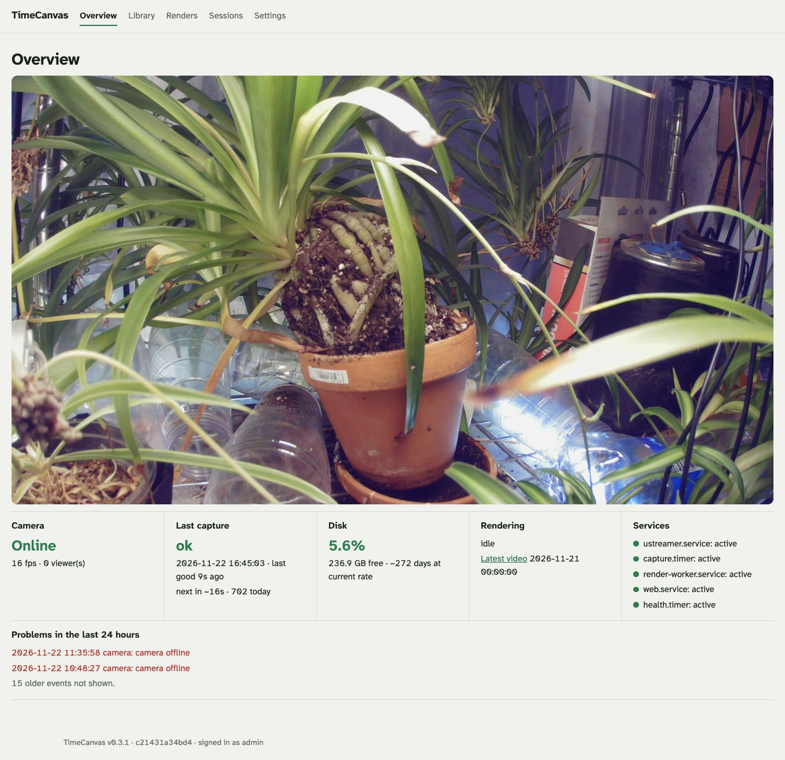
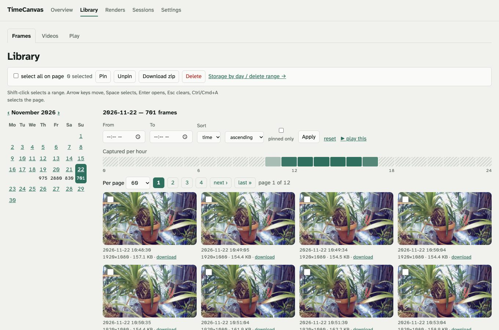
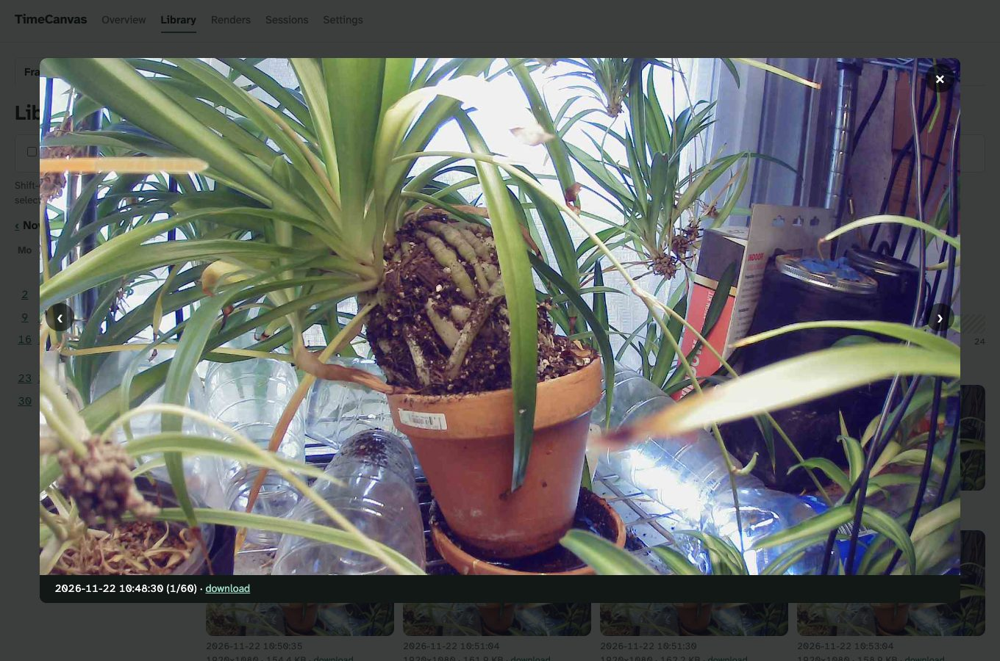
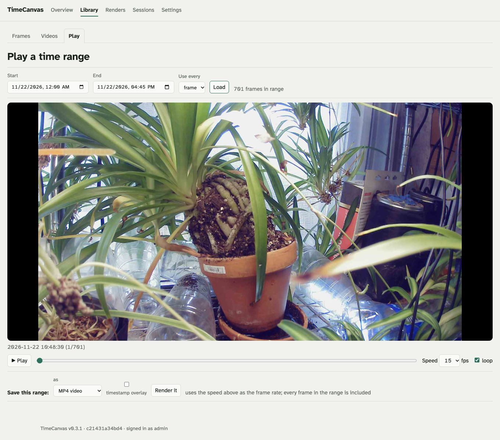
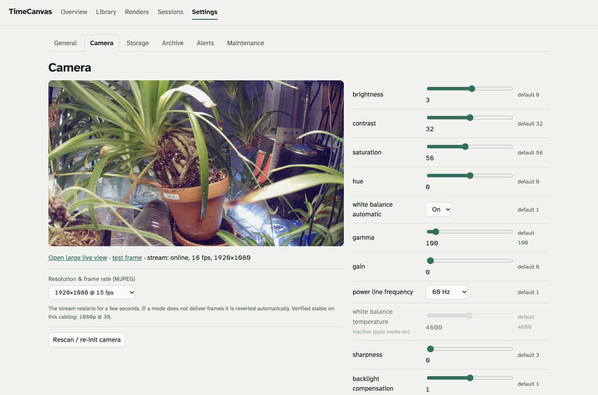
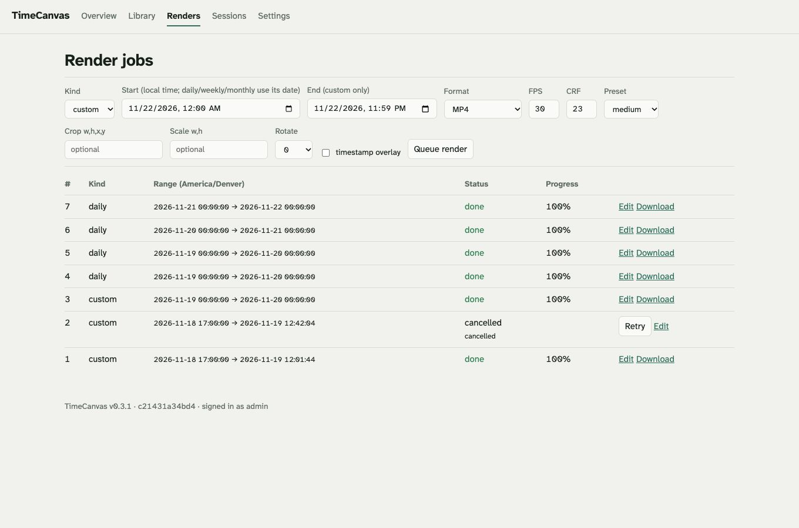
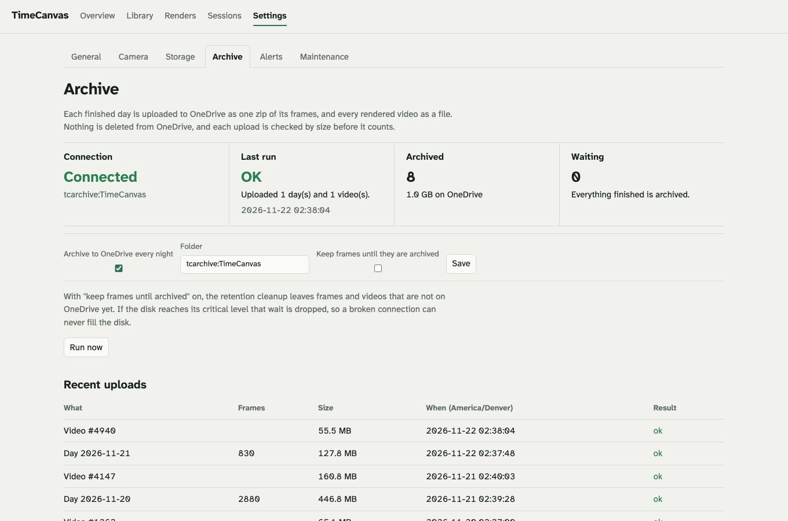
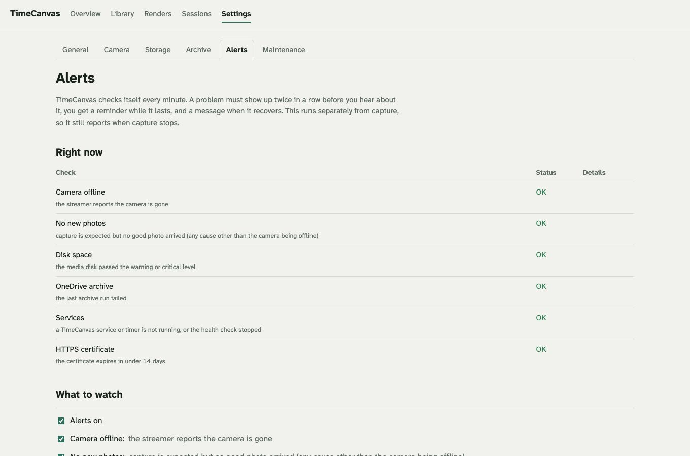
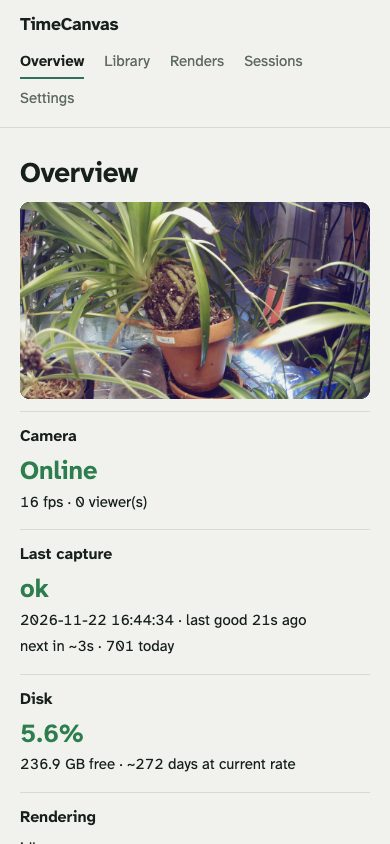

# TimeCanvas

A self-hosted, dashboard-driven **USB-camera timelapse appliance**. Plug a UVC webcam into a small Linux VM (or any Debian box), and TimeCanvas captures a frame on a schedule, keeps an indexed archive, renders timelapse videos, and tells you when something goes wrong.



## What it does
- **Captures** a frame every N seconds (default 30) from one camera, with per-session intervals, day/hour schedules and disk-space guards. Only `ustreamer` opens the camera, so the live view and the captures never fight over the device.
- **Indexes** every frame in SQLite and stores it in a dated folder tree; a reconcile job keeps the index and the disk in agreement.
- **Renders** daily, weekly, monthly or custom time ranges to MP4 or animated WebP with FFmpeg (exact local start/end times, crop, scale, rotate, timestamp overlay).
- **Plays** any time range in the browser like a GIF, then saves exactly that range as a video.
- **Archives** finished days (zips) and videos to OneDrive, upload-only and size-verified.
- **Alerts** you through a Microsoft Teams (Power Automate) webhook and email (Postal API or SMTP), with an optional heartbeat ping, when the camera goes offline, captures stop, the disk fills, the archive fails, a service stops or the certificate is about to expire.
- **Stays small and locked down:** FastAPI + Jinja2 + HTMX behind Nginx (HTTPS, Basic Auth), systemd-hardened services, HTMX plus a little plain JavaScript, no CDN, a strict Content-Security-Policy.

## Screenshots

| | |
|---|---|
|  |  |
| **Library > Frames:** calendar, hourly capture strip, time-of-day filter, sort, pagination, shift-click and keyboard selection. | **Pop-up viewer:** click any frame or video; arrow keys step through the set. |
|  |  |
| **Play:** watch a range as an animation, then save it as MP4 or animated WebP. | **Settings > Camera:** live preview, resolution/fps, every image control the camera exposes. |
|  |  |
| **Renders:** queued, running and finished jobs, editable and retryable. | **Settings > Archive:** nightly upload status and history. |
|  |  |
| **Settings > Alerts:** what is watched and its current state; one test button per channel. | **Mobile:** the same dashboard on a phone. |

More: [Videos](docs/images/library-videos.jpg), [Storage](docs/images/settings-storage.jpg), [General settings](docs/images/settings-general.jpg), [Maintenance](docs/images/settings-maintenance.jpg). The images are real captures from a running install (v0.3.1).

## How it fits together
```
USB camera -> Proxmox USB passthrough -> VM "timecanvas" -> ustreamer (127.0.0.1:8080)
   -> capture tick (30 s slots) -> /srv/timecanvas/images + SQLite index
   -> render worker (FFmpeg)    -> /srv/timecanvas/videos
   -> archive job (rclone)      -> OneDrive (finished-day zips + videos)
   -> dashboard (127.0.0.1:8000) -> Nginx :443 (TLS via Tailscale cert, Basic Auth)
```
The reference deployment is a Debian 13 VM on Proxmox with the camera passed through by USB ID, reached over Tailscale. Nothing in the application requires Proxmox or Tailscale; those are deployment choices described in [INSTALL](docs/INSTALL.md) and [ACCESS](docs/ACCESS.md).

## Requirements
- Debian 13 (or a close relative) with a UVC webcam; the reference VM has 2 vCPU, 2 GiB RAM, a 24 GiB system disk and a 256 GiB media disk, and 1080p every 30 s adds about 450 MB of frames a day (frames are kept 30 days by default).
- Python 3.13, FFmpeg, `ustreamer`, Nginx, `rclone` (only for the OneDrive archive). `scripts/baseline.sh` installs what the VM needs.
- A short, solid USB path to the camera. Long passive extensions and hubs caused outages here; an active repeater fixed it ([CAMERA_CAPABILITIES](docs/CAMERA_CAPABILITIES.md)).

## Quick start
The full procedure, including the Proxmox VM creation, is in [docs/INSTALL.md](docs/INSTALL.md). On a machine that already has the camera attached:

1. Clone the repository and review `scripts/baseline.sh`, `scripts/install.sh` and `scripts/deploy.sh` (they are short and meant to be read first).
2. Run the baseline on the VM once. From your workstation deploy a tagged release over SSH with `TC_HOST=user@vm-address scripts/deploy.sh vX.Y.Z`, create the Nginx login (`htpasswd`) on the VM, and open the dashboard.
3. Switch capture on under Settings > General, add alerts under Settings > Alerts, and optionally connect OneDrive under Settings > Archive.

To develop or run the tests, see [docs/DEVELOPMENT.md](docs/DEVELOPMENT.md). Never edit files on a deployed VM; change the repository and redeploy.

## Documentation
| Read this | for |
|---|---|
| [docs/USER_GUIDE.md](docs/USER_GUIDE.md) | using the dashboard day to day |
| [docs/INSTALL.md](docs/INSTALL.md) | building it from scratch |
| [docs/ACCESS.md](docs/ACCESS.md) | how to reach the Proxmox host and the VM; trusted HTTPS |
| [docs/OPERATIONS.md](docs/OPERATIONS.md) | status, logs, manual jobs, disk growth, upgrades, rollback |
| [docs/CONFIGURATION.md](docs/CONFIGURATION.md) | every setting and where it lives |
| [docs/ARCHITECTURE.md](docs/ARCHITECTURE.md) | how the pieces fit, units, locks, schema |
| [docs/SECURITY.md](docs/SECURITY.md) | threat model and controls |
| [docs/ARCHIVE.md](docs/ARCHIVE.md) | OneDrive archive setup and behaviour |
| [docs/ALERTS.md](docs/ALERTS.md) | Teams / email alerts when the camera, capture, disk or services misbehave |
| [docs/BACKUP_AND_RESTORE.md](docs/BACKUP_AND_RESTORE.md) | backups, restore, rebuild from a tag |
| [docs/TROUBLESHOOTING.md](docs/TROUBLESHOOTING.md) | symptom -> check |
| [docs/CAMERA_CAPABILITIES.md](docs/CAMERA_CAPABILITIES.md) | what the camera supports and what was measured |
| [docs/DEVELOPMENT.md](docs/DEVELOPMENT.md) | git flow, tests, deploy, releasing, documentation standard |
| [CONTRIBUTING.md](CONTRIBUTING.md) | how to propose a change |
| [CHANGELOG.md](CHANGELOG.md) | what changed per release |
| [deploy-log/](deploy-log/) | the author's deployment records and acceptance results (see its [README](deploy-log/README.md)) |

## About the example values
Hostnames, tailnet names, IP addresses, the camera USB ID and the VM number in the docs and scripts come from the author's own installation (`pve-pueblo`, VM 102, camera `05a3:9422`). Replace them with yours; the Proxmox scripts in `infra/proxmox/` check the host name before they change anything.

## Status
Version 0.3.x, running continuously on the reference install. What was verified, by whom, and what was not is recorded in [deploy-log/test-results.md](deploy-log/test-results.md).

## License
GPL-3.0, see [LICENSE](LICENSE). The bundled Atkinson Hyperlegible Next font is SIL OFL 1.1 (`app/timecanvas/web/static/fonts/`).
