# User guide

Screenshots are real captures from a running install (v0.3.1, 2026-11-22); see DEVELOPMENT for how to retake them.

Open the dashboard at `https://<vm>.<tailnet>.ts.net/` (see ACCESS) and sign in with the Basic Auth user. The top bar is **Overview, Library, Renders, Sessions, Settings**. Library and Settings have tabs under the bar.

## Overview

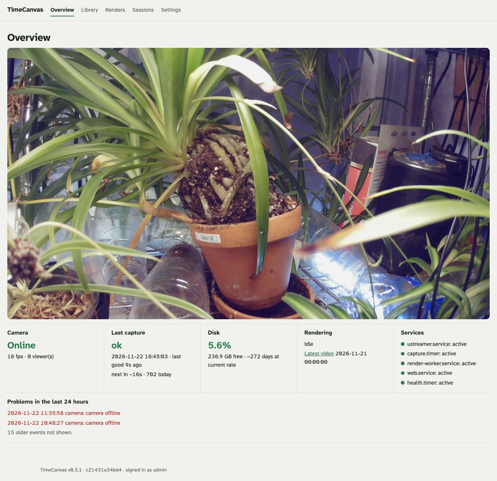The live feed (click it for a large pop-up), then a status band: camera online/fps, last capture and the next slot, disk use and days left at the current rate, render progress with a link to the latest video, service states, and problems from the last 24 hours (older events are counted, not listed).

## Library

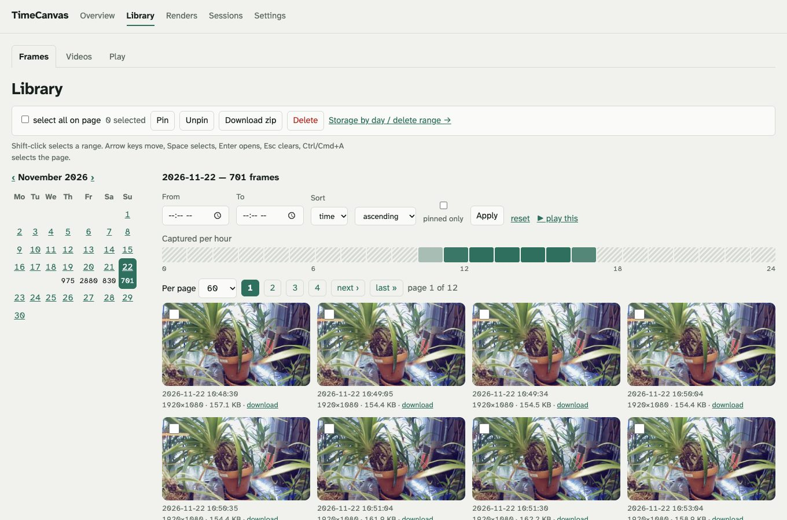**Frames tab.** Pick a day in the calendar (the number is that day's frame count).
- **Capture strip:** 24 hourly cells for the day, shaded by how many frames exist against what the interval should give; hatched cells are gaps. Click an hour to filter the list to it.
- **Filters:** From/To time of day, sort by time or size (ascending/descending), pinned only. **Per page:** 24, 60, 120 or 240, with first/prev/numbered/next/last links. Your page size is kept when you change day.
- **Pop-up viewer:** a plain click on a frame or video opens it over the page. Esc, the × button or a click outside closes it; ← → step through items; the caption has a download link. Cmd/Ctrl-click or middle-click opens it in a browser tab instead.
- **Selecting:** tick boxes; **Shift-click** selects everything between your last click and this one. Keyboard: arrows move the highlight, Space selects, Shift+arrow extends, Enter opens, Esc clears, Ctrl/Cmd+A selects the page (ignored while you type in a field).
- **Actions on the selection:** Pin, Unpin, Download zip (max 3000 files / 3 GiB), Delete (asks first). Pinned items and frames inside queued or running renders are never deleted.
- "▶ play this" opens the Play tab for the current day/time filter.

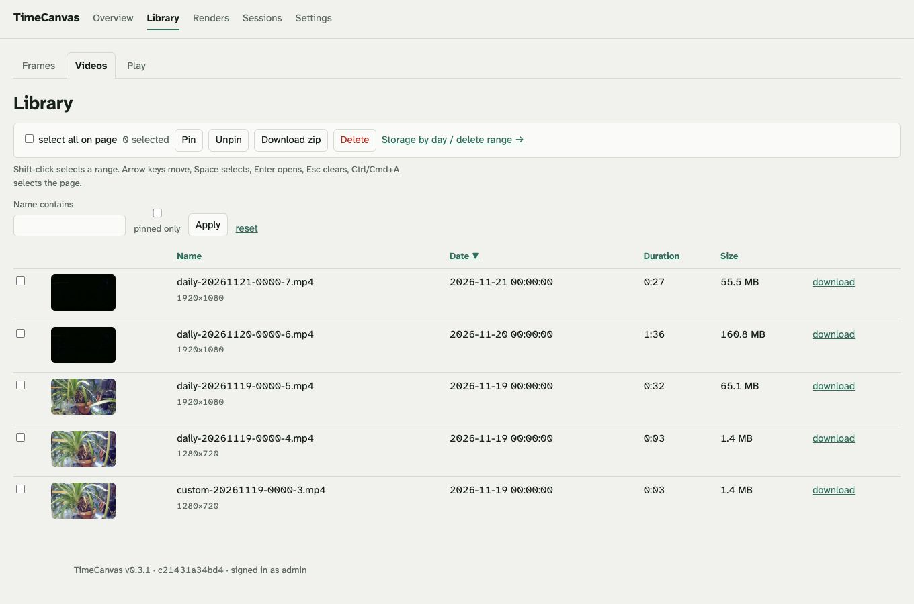

**Videos tab.** Name filter, pinned only, sort by name/date/duration/size, same selection and viewer. Animated WebP renders open in the viewer as images.

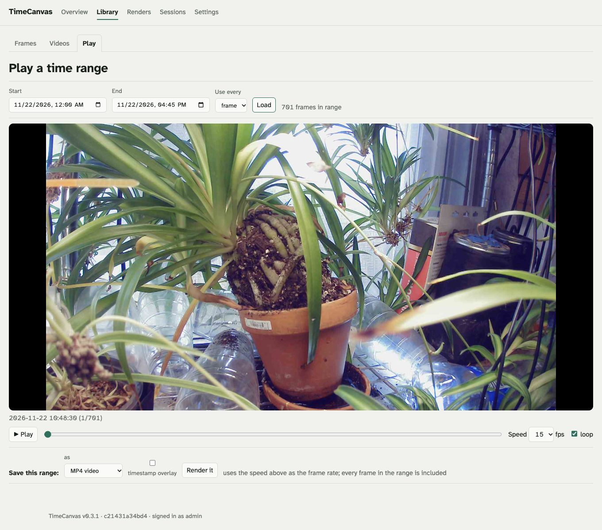

**Play tab.** Choose a start and end (local time) and press Load. Every frame of the range starts downloading in the background right away, and a progress bar under the picture shows how many have arrived; you can press Play at once, and playback pauses on a frame until it has arrived rather than skipping it. Play/pause, scrub, speed 2-60 fps, "use every Nth frame", loop. Up to 3000 frames are loaded (the step widens automatically beyond that). **Save this range** queues a render of exactly that range as MP4 or animated WebP at the speed you chose; the result appears under Library > Videos.

## Renders

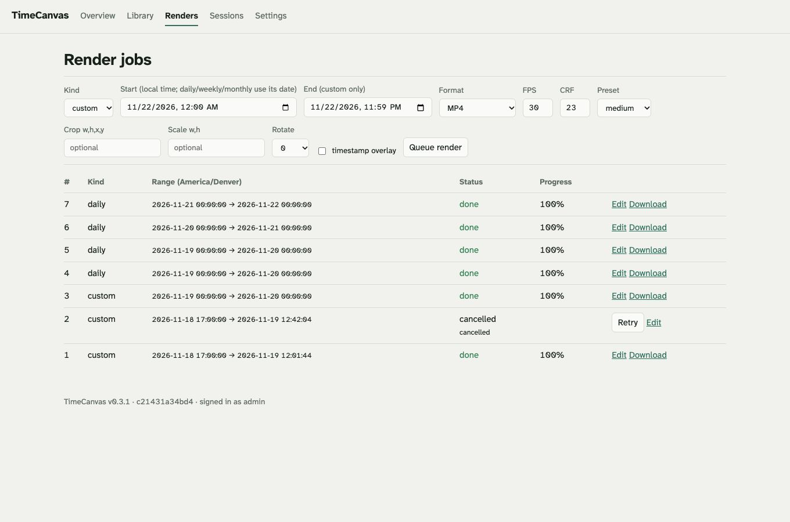Kind: daily/weekly/monthly (use the date part of Start) or custom (exact local Start and End; an end before the start is refused). Format MP4 (h264, yuv420p) or animated WebP (width capped at 960 px). FPS, CRF, preset, optional crop `w,h,x,y`, scale `w,h`, rotate, timestamp overlay. Times in the job list are local. Failed or cancelled jobs can be retried; running ones cancelled. **Edit** on any job loads its settings back into the form (times shown in local time): a queued, failed or cancelled job is changed in place and queued again; a finished job keeps its video and the edited settings become a new job; a running job must be cancelled first.

## Sessions
Name, start/end, optional capture interval (10-3600 s) and days (0=Mon..6=Sun) / hours. The newest active session overrides the default interval and schedule. **Edit** loads a session back into the form and saves changes in place. Deleting a session keeps its media.

## Settings
- **General:** capture on/off, interval, retention (frames 30 d, videos 365 d by default), disk warning/critical %, render defaults, timezone.
- **Camera:** live preview next to the controls; changes apply instantly and persist across reboots and replugs. Choose resolution/fps from the camera's own list (a mode that delivers no frames is reverted automatically). Profiles save and restore a set of values; Reset returns to camera defaults. "Open large live view" shows the stream in the pop-up.
- **Storage:** every day of a month with frames, size, pins and videos (empty days are collapsed), per-day Pin day / Unpin / Zip / Delete unpinned / Render. **Delete a range** previews the count, size and what is kept before you confirm.
- **Archive:** OneDrive connection status, last run, what is waiting, folder, nightly on/off, keep-until-archived, Run now, recent uploads. Setup: docs/ARCHIVE.md.
- **Alerts:** what is being watched and its current state, thresholds, the Teams webhook, email, an optional heartbeat URL, one **Test** button per channel (Teams, email, heartbeat) plus a test of everything switched on, and the recent messages with delivery results. Setup: docs/ALERTS.md.
- **Maintenance:** version/commit, storage by type, retention dry run, reconcile index with disk, regenerate thumbnails, export config, diagnostic bundle, logs per service, and the audit log (bulk actions are grouped, e.g. "and 29 more like it").

### Screenshots of the Settings tabs

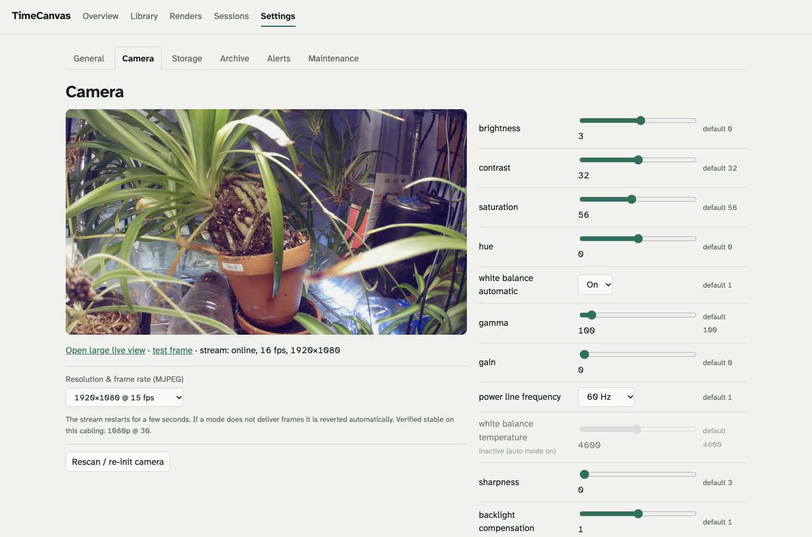

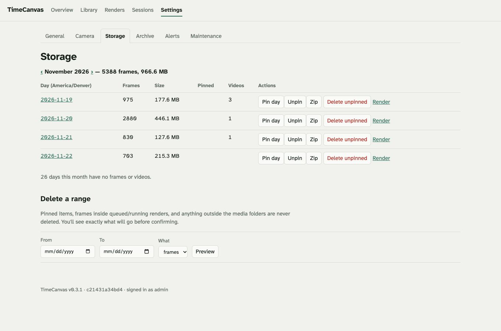

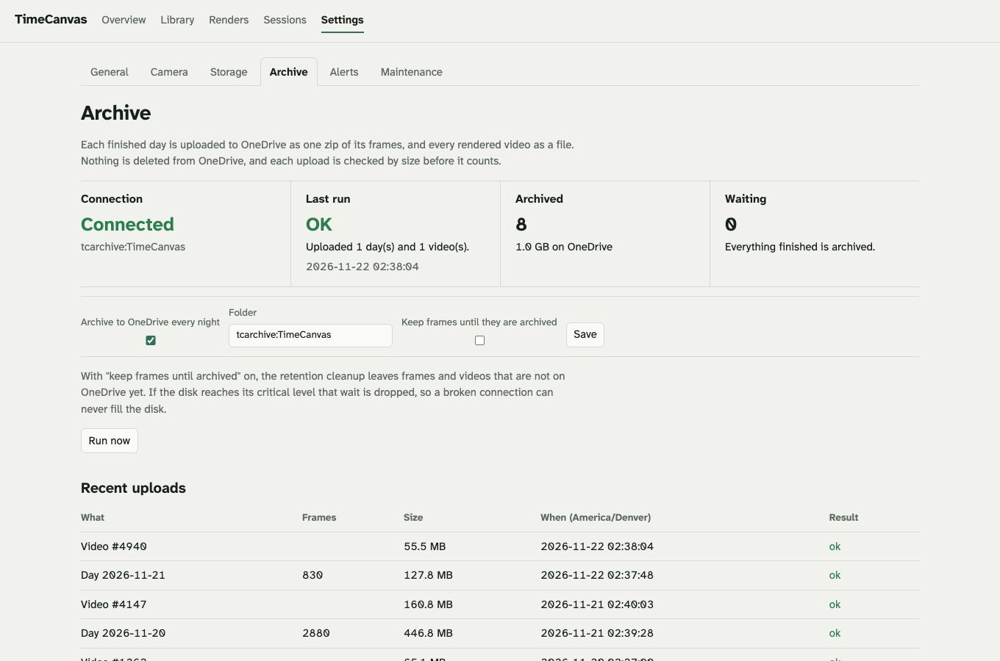

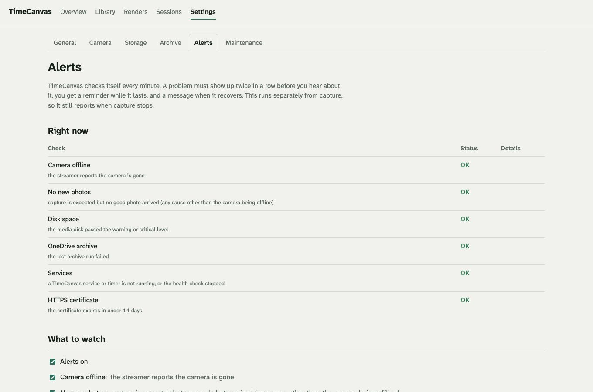

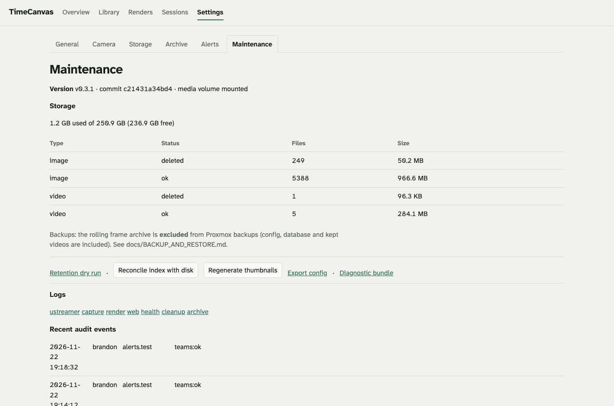

On a phone the layout collapses to one column:

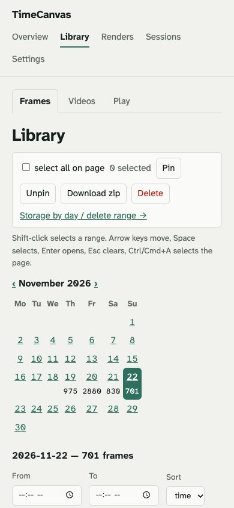

## Everything that deletes
Only these paths delete media: retention (nightly, never pinned/protected/in-render, waits for the archive), single/bulk delete in Library, per-day and range delete in Storage. Every one is audited (Maintenance > audit).
